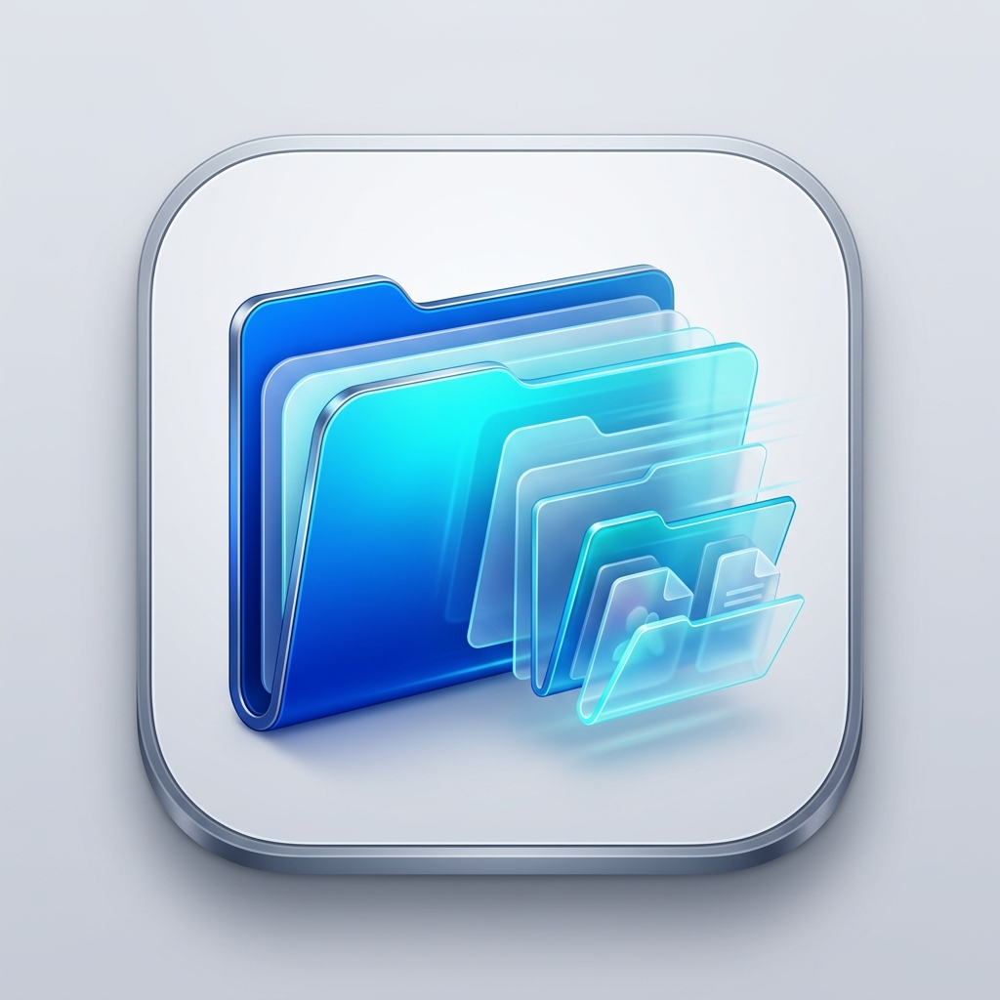

# QuiFi — Quick File Organizer for macOS

<p align="center">
  <br><br>
  <b>Blitzschnelle Dateiablage per Drag & Drop mit kaskadierendem Ordnerbaum für macOS.</b><br>
  <i>Kein lästiges Suchen durch Finder-Fenster mehr. Greife eine Datei, rüttle kurz mit der Maus oder halte Command – und lege sie direkt im richtigen Unterordner ab.</i>
</p>

<p align="center">
  
  
  
  
</p>

---

## 💡 Was ist QuiFi?

Inspiriert von innovativen macOS-Interaktionsmustern wie *Filee* und *Dropover*, löst **QuiFi** das tägliche Problem unübersichtlicher Dateiablagen:

1. Du nimmst eine Datei im Finder (z. B. aus deinem **Downloads**-Ordner).
2. Du rüttelst die Maus kurz hin und her **oder** hältst die `⌘ Command`-Taste.
3. Direkt an deinem Mauszeiger öffnet sich ein schwebendes HUD mit deinen **gepinnten Lieblingsordnern**.
4. Sobald du über einen Ordner hoverst (z. B. *Lohnlauf*), klappen in Miller-Spalten automatisch die Unterordner auf (*2026* → *01_Januar*).
5. Du lässt die Maustaste los – die Datei ist sofort an Ort und Stelle!

```
[Mauszeiger mit Datei]
          │
          ▼  (Shake oder ⌘ halten)
┌───────────────────┐ ┌───────────────────┐ ┌───────────────────┐
│ Favoriten         │ │ Lohnlauf          │ │ 2026              │
├───────────────────┤ ├───────────────────┤ ├───────────────────┤
│ 📁 Downloads      │ │ 📁 2024           │ │ 📁 01_Januar      │
│ 📁 Lohnlauf    ───┼─► 📁 2025           │ │ 📁 02_Februar ◄───┼─ [DROP!]
│ 📁 Buchhaltung    │ │ 📁 2026        ───┼─► 📁 03_März        │
│ 📁 Projekte       │ │ 📁 Vorlagen       │ │ ...               │
└───────────────────┘ └───────────────────┘ └───────────────────┘
```

---

## ✨ Features

* **⚡ Spontanes HUD am Mauszeiger:** 
  * **Shake-to-Show:** Kurzes Rütteln beim Ziehen blendet das HUD ein.
  * **Modifier-Taste:** Alternativ `⌘ Command` oder `⌥ Option` beim Ziehen halten.
  * Frei konfigurierbar in den Einstellungen.
* **🗂️ Kaskadierende Unterordner (Miller Columns):**
  * Schwebe über einen Ordner, und seine echten Unterordner erscheinen snappig in der nächsten Spalte.
  * Beliebig tiefe Navigation möglich.
* **🔄 Verschieben oder Kopieren:**
  * Standard: Immer **Verschieben** (für saubere Downloads-Ordner).
  * Hältst du beim Ablegen `⌥ Option` gedrückt, wird die Datei stattdessen **kopiert** (inkl. optischem `+` Badge).
* **🛡️ Intelligente Konfliktlösung:**
  * Wenn die Datei am Zielort bereits existiert: Schneller Dialog (**Ersetzen**, **Umbenennen**, **Abbrechen**).
  * Einstellbare Umbenennungsregeln:
    * Zähler: `Dateiname_1.pdf` oder `Dateiname (1).pdf`
    * Datum: `Dateiname_2026-10-16.pdf`
    * Zeitstempel: `Dateiname_20261016_114000.pdf`
* **👁️ Finder-Konformität:**
  * Übernimmt automatisch die Finder-Einstellung für versteckte Ordner (`AppleShowAllFiles`).
* **🪶 100% Nativ & Leichtgewichtig:**
  * Entwickelt in **Swift** und **SwiftUI**.
  * Unauffälliges Menüleisten-Applet (`LSUIElement`), kein störendes Dock-Icon.
  * Läuft vollständig offline – keine Telemetrie, 100% Datenschutz.

---

## 🛠️ Installation & Start

### Option 1: Fertiges Release herunterladen (Empfohlen)
1. Lade die **`QuiFi.dmg`** aus den [Releases](https://github.com/alxkns/Quifi/releases) herunter.
2. Öffne die DMG und ziehe **`QuiFi.app`** in deinen **`Applications`**-Ordner.
3. **Erster Start & macOS Gatekeeper:**
   * Da QuiFi als unabhängiges Open-Source-Projekt noch nicht über ein kostenpflichtiges Apple-Entwicklerzertifikat notarisiert ist, beim ersten Start einfach: **Rechtsklick auf `QuiFi` > „Öffnen“** anklicken (oder unter *Systemeinstellungen > Datenschutz & Sicherheit > Dennoch öffnen* bestätigen).
   * Erlaube QuiFi einmalig die **Bedienungshilfen (Accessibility)** unter *Systemeinstellungen > Datenschutz & Sicherheit > Bedienungshilfen*, damit es globale Drag-Events erkennen kann.
4. QuiFi nistet sich direkt oben in deiner **macOS-Menüleiste** ein (`folder.badge.gearshape`). Klickst du darauf, kommst du zu den Einstellungen.

### Option 2: Selbst bauen (Entwickler)
QuiFi nutzt den modernen Swift Package Manager:

```bash
git clone https://github.com/alxkns/Quifi.git
cd Quifi

# Unit Tests ausführen
swift test

# Fertige .app und .zip bauen
./Scripts/build_app.sh --zip
```
Die fertige App findest du anschließend in `build/QuiFi.app`.

---

## ⚙️ Einstellungen

Über das Menüleisten-Icon (`folder.badge.gearshape`) gelangst du zu den Einstellungen:
* **Ordner:** Füge beliebig viele Favoriten-Ordner von deiner Festplatte hinzu, sortiere sie um oder entferne sie.
* **Trigger:** Aktiviere/deaktiviere Rütteln (mit Empfindlichkeitsregler) und die Modifier-Taste.
* **Konflikte:** Lege fest, ob bei gleichnamigen Dateien nachgefragt werden soll oder automatisch mit deinem Wunschmuster umbenannt wird.
* **Allgemein:** Haptisches Feedback aktivieren, Bedienungshilfen-Status prüfen.

---

## 🏗️ Architektur

* `Sources/QuiFiKit/`
  * `Models/`: `PinnedFolder`, `FolderNode`, `Preferences`
  * `Services/`:
    * `EventTapManager`: Low-Level `CGEventTap` für globales Drag- und Modifier-Tracking
    * `ShakeDetector`: Zeitfenster-basierte Richtungswechsel-Erkennung für das Maus-Rütteln
    * `FolderScanner`: Verzeichnis-Inspektor mit `localizedStandardCompare` und `AppleShowAllFiles`-Filter
    * `FileOrganizerService`: Atomic Move/Copy mit automatischer Namensgenerierung
  * `UI/`:
    * `HUDWindowController`: Schwebendes, rahmenloses `NSPanel` mit Schirmrand-Erkennung
    * `CascadingFolderView`: SwiftUI Miller-Columns mit Drag & Drop Integration
    * `SettingsView`: Ausführliches Einstellungsfenster mit 4 Reitern
* `Sources/QuiFi/`:
  * App-Bootstrap, `AppDelegate` und `main.swift`

---

## 📄 Lizenz

Dieses Projekt ist unter der **MIT-Lizenz** lizenziert — siehe [LICENSE](LICENSE) für Details.
